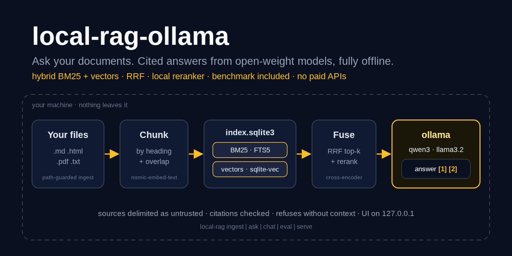
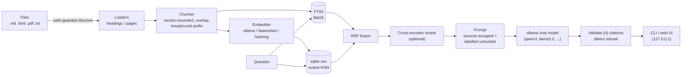

# local-rag-ollama

> Ask questions about your own documents and get cited answers, entirely on your machine:
> structure-aware chunking, hybrid BM25 + vector retrieval with reciprocal rank fusion, an
> optional local cross-encoder reranker, open-weight models on ollama, a web UI, and a
> benchmark that measures all of it.

[](https://github.com/MartinCastroAlvarez/local-rag-ollama/actions/workflows/ci.yml)
[](LICENSE)
[](pyproject.toml)
[](pyproject.toml)



Point `local-rag` at a folder of Markdown, HTML, PDF and text files. It splits them along
their headings, indexes every chunk twice (BM25 and embeddings) in one SQLite file, and
answers questions with a local model, citing each claim as `[n]`. If the documents don't
contain the answer, it says so instead of guessing.

**Runs 100% locally, no paid APIs required.** Embeddings and answers come from
[ollama](https://ollama.com). The index is SQLite with FTS5 and
[sqlite-vec](https://github.com/asg017/sqlite-vec). There is no telemetry, and ollama
must be on loopback unless you opt in. The tests use a fake embedder and a fake LLM and
never touch the network.

## Why

- **Your documents are private.** Contracts, notes and medical letters shouldn't be sent
  to a hosted API to be searched. Here nothing leaves the machine, and that is enforced:
  remote ollama hosts are refused, redirects are never followed, and the UI only binds
  to `127.0.0.1`.
- **Hybrid retrieval beats either half.** BM25 finds exact terms ("Article 1, Section 8",
  error codes). Vectors find paraphrases. Reciprocal rank fusion combines the two without
  tuning score scales.
- **Answers must be checkable.** Every claim cites a numbered source. Citations to
  sources that don't exist are removed, and the UI opens the exact chunk behind each
  `[n]`.
- **Measure, don't vibe.** `local-rag eval` reports recall@k, MRR, faithfulness and
  per-stage latency for each retrieval mode on a bundled public-domain corpus.

## Quickstart

```bash
pip install "local-rag-ollama @ git+https://github.com/MartinCastroAlvarez/local-rag-ollama"
ollama pull nomic-embed-text && ollama pull qwen3:4b
local-rag ingest ~/Documents/notes                      # .md .html .pdf .txt, incremental
local-rag ask "What did we decide about the Q3 budget?"  # streamed answer + [n] sources
local-rag serve                                          # web UI on http://127.0.0.1:8765
```

No ollama? `pip install "local-rag-ollama[fastembed] @ git+…"` and
`--embedder fastembed` (ONNX on CPU) or `--embedder hashing` (no model at all) still
index and retrieve (`local-rag ask … --retrieve-only`). `python -m examples.quickstart`
runs the whole retrieval path on the bundled corpus.

```text
$ local-rag ask "Who has the sole power to try impeachments?"
The Senate has the sole power to try all impeachments [1]; the House of Representatives
has the sole power of impeachment [2].

Sources:
 *[1] us-constitution.md - The Constitution of the United States of America (1787) > Article 1 > Section 3
 *[2] us-constitution.md - The Constitution of the United States of America (1787) > Article 1 > Section 2
  [3] us-constitution.md - The Constitution of the United States of America (1787) > Article 1 > Section 1
```

The answer text above shows the format; it was not generated here, because this host has
no ollama. The three sources are the real top 3 from `hybrid` retrieval over the bundled
corpus with the hashing embedder (`python -m examples.quickstart` prints them).

## How it works



1. **Ingest.** The folder is walked without following directory symlinks, and nothing
   resolving outside it or hidden (`.git`, `.env`) is read. Each loader keeps structure:
   Markdown and HTML headings, ALL-CAPS or `CHAPTER` lines in text, pages in PDFs (pypdf).
   Files are re-indexed only when their content hash changes.
2. **Chunk.** A chunk never crosses a heading or page. Paragraphs are packed to about
   1200 characters, with 200 characters of sentence-aligned overlap. The breadcrumb
   (`Title > Article 1 > Section 8`) is embedded and indexed with the text, so a query
   that names a section finds it.
3. **Index.** One SQLite file holds documents, chunks, an FTS5 table (BM25, porter
   stemming) and a sqlite-vec `vec0` table (cosine). It is created `0600`.
4. **Retrieve.** Choose one mode: `bm25`, `vector`, `hybrid` (RRF, `k = 60`) or
   `hybrid+rerank` (a local `ms-marco-MiniLM-L-6-v2` cross-encoder re-scores the top 30).
5. **Answer.** The model sees the rules first, then the sources as escaped, numbered
   `<source trust="untrusted">` blocks, then the question. It must cite `[n]` or reply
   with the exact refusal sentence. Tokens stream to the CLI and the UI.
   [ARCHITECTURE.md](ARCHITECTURE.md) explains why sqlite-vec was chosen over Chroma and
   LanceDB.

## Benchmark

`local-rag eval` indexes a bundled corpus into a temporary index and runs a 45-question
set against it. The corpus is four public-domain works in four formats: the US
Constitution (Markdown), Sun Tzu's *Art of War* (text), Strunk's *Elements of Style*
(HTML) and Thoreau's *Civil Disobedience* (PDF). The 45 questions are 41 answerable, each
labelled with a verbatim evidence span, and 4 the corpus can't answer. A chunk counts as
relevant when it contains the evidence span from the right document.

Retrieval, 41 answerable questions, 255 chunks. Measured on 2026-10-24 on a 1-vCPU
aarch64 Linux container (`LOCAL_RAG_THREADS=1`).

**`--embedder fastembed`** (`BAAI/bge-small-en-v1.5`, 384d, ONNX on CPU):

| Mode | Recall@1 | Recall@3 | Recall@5 | Recall@10 | MRR@10 | Retrieval ms/query |
| --- | ---: | ---: | ---: | ---: | ---: | ---: |
| bm25 | 0.854 | 0.951 | 0.951 | 1.000 | 0.902 | 0.2 |
| vector | 0.659 | 0.854 | 0.927 | 0.976 | 0.768 | 21.3 |
| hybrid | 0.854 | 0.951 | 1.000 | 1.000 | 0.908 | 16.7 |
| hybrid+rerank | 0.829 | 0.951 | 1.000 | 1.000 | 0.901 | 3095.3 |

**`--embedder hashing`** (no model; signed feature hashing, 512d):

| Mode | Recall@1 | Recall@3 | Recall@5 | Recall@10 | MRR@10 | Retrieval ms/query |
| --- | ---: | ---: | ---: | ---: | ---: | ---: |
| bm25 | 0.854 | 0.951 | 0.951 | 1.000 | 0.902 | 0.4 |
| vector | 0.512 | 0.659 | 0.756 | 0.805 | 0.607 | 1.0 |
| hybrid | 0.707 | 0.854 | 0.878 | 0.951 | 0.787 | 1.0 |
| hybrid+rerank | 0.854 | 0.951 | 1.000 | 1.000 | 0.915 | 3349.7 |

The raw results, with per-stage timings, are in [`docs/benchmark/`](docs/benchmark).
How to read them:

- **Hybrid is the safe default.** With a real embedding model it ties or beats both
  halves on every column and is the only mode with recall@5 = 1.0 without a reranker.
  Fusing with a weak, lexical "embedding" (hashing) drags it down, so use a real model.
- **BM25 is strong here** because the questions were written while reading the texts and
  share their vocabulary. Expect vectors to matter more on paraphrased, real-world
  questions.
- **The reranker costs about 3 s per query on one CPU core** (30 candidates). It rescues
  the weak hashing setup but adds nothing over bge-small hybrid on this small set. It is
  opt-in for that reason.
- Ingest took 43 s for 255 chunks with bge-small and 2.5 s with hashing on the same
  core.

**Generation metrics: run locally.** This host has no ollama, so we publish no answer
numbers. With ollama running,
`local-rag eval --embedder ollama --generation-mode hybrid` adds:

- answer rate on the 41 answerable questions;
- refusal rate on the 4 unanswerable ones;
- citation rate and citation precision;
- faithfulness: the judge model (`LOCAL_RAG_JUDGE_MODEL`) grades each answer
  supported / partial / unsupported against its sources;
- generation latency and time to first token.

## Configuration

Every setting is an environment variable; the main ones also have CLI flags.

| Variable | Default | Meaning |
| --- | --- | --- |
| `OLLAMA_HOST` | `http://127.0.0.1:11434` | ollama endpoint; must be loopback |
| `LOCAL_RAG_ALLOW_REMOTE_OLLAMA` | `0` | allow a non-loopback ollama you control |
| `LOCAL_RAG_DB` | `~/.local/share/local-rag/index.sqlite3` | index file (`--db`) |
| `LOCAL_RAG_EMBEDDER` | `ollama` | `ollama`, `fastembed` or `hashing` (`--embedder`) |
| `LOCAL_RAG_EMBED_MODEL` | `nomic-embed-text` | ollama embedding model, e.g. `bge-m3` (`--embed-model`) |
| `LOCAL_RAG_FASTEMBED_MODEL` | `BAAI/bge-small-en-v1.5` | model for `--embedder fastembed` |
| `LOCAL_RAG_CHAT_MODEL` | `qwen3:4b` | ollama chat model, e.g. `llama3.2:3b` (`--chat-model`) |
| `LOCAL_RAG_JUDGE_MODEL` | chat model | faithfulness judge for `eval` (`--judge-model`) |
| `LOCAL_RAG_MODE` | `hybrid` | `bm25`, `vector`, `hybrid`, `hybrid+rerank` (`--mode`) |
| `LOCAL_RAG_TOP_K` | `5` | chunks given to the model (`-k`) |
| `LOCAL_RAG_CANDIDATES` | `30` | per-retriever depth before fusion / rerank |
| `LOCAL_RAG_RRF_K` | `60` | RRF constant |
| `LOCAL_RAG_RERANK_MODEL` | `Xenova/ms-marco-MiniLM-L-6-v2` | fastembed cross-encoder |
| `LOCAL_RAG_MIN_SIMILARITY` | `0.3` | relevance gate (only when no query term matches) |
| `LOCAL_RAG_CHUNK_CHARS` / `LOCAL_RAG_OVERLAP_CHARS` | `1200` / `200` | chunking |
| `LOCAL_RAG_MAX_FILE_BYTES` | `20971520` | per-file ingest limit |
| `LOCAL_RAG_THREADS` | `0` (auto) | fastembed CPU threads |
| `LOCAL_RAG_TEMPERATURE` / `LOCAL_RAG_TIMEOUT` | `0` / `120` | generation settings |

See [`.env.example`](.env.example). Queries always use the embedder that built the
index. To switch embedders, run `local-rag ingest --rebuild`.

## Commands

| Command | What it does |
| --- | --- |
| `local-rag ingest PATH... [--rebuild] [--prune]` | index files or folders (incremental) |
| `local-rag ask "..." [--mode M] [-k N] [--json] [--retrieve-only]` | one answer, streamed, with sources |
| `local-rag chat` | question loop with follow-ups (`/reset`, `/quit`) |
| `local-rag eval [--modes ...] [--no-generation] [--output r.json]` | the benchmark above |
| `local-rag serve [--port 8765]` | web UI on 127.0.0.1: streaming answers, clickable citations |
| `local-rag status` | what is indexed, with which embedder |

## Security

Documents are untrusted input. Sources are HTML-escaped and wrapped in labelled
`<source trust="untrusted">` blocks after the rules. Invented citations are stripped.
Ingest refuses symlinks and paths outside the root. The UI binds to loopback, checks
`Host` and `Origin`, sends a strict CSP and renders text only with `textContent`. Nothing
is sent anywhere. Threat model and disclosure policy: [SECURITY.md](SECURITY.md).

## Testing

```bash
poetry install
poetry run pytest                # 161 offline tests, ~97% coverage
poetry run ruff check local_rag tests examples scripts && poetry run mypy local_rag
poetry run bandit -c pyproject.toml -q -r local_rag && poetry run pip-audit
```

The tests use the hashing embedder, a scripted fake LLM, a fake reranker and
`httpx.MockTransport` for the ollama client. They cover loaders, chunking, both vector
paths (sqlite-vec and the Python fallback), fusion, the pipeline, the web API, the CLI
and the benchmark. Security tests include a prompt-injection document, symlink escapes,
DNS rebinding, cross-origin posts and an AST ban on `eval`/`pickle`/`subprocess`.

## Part of the series

| Series | Repositories |
| --- | --- |
| Apps | **local-rag-ollama** · [ui-review-agent](https://github.com/MartinCastroAlvarez/ui-review-agent) |
| Agent tooling | [agent-lint](https://github.com/MartinCastroAlvarez/agent-lint) · [repo-graph-mcp](https://github.com/MartinCastroAlvarez/repo-graph-mcp) · [s3-agent-memory](https://github.com/MartinCastroAlvarez/s3-agent-memory) · [pytest-llm-evals](https://github.com/MartinCastroAlvarez/pytest-llm-evals) · [serverless-mcp-aws](https://github.com/MartinCastroAlvarez/serverless-mcp-aws) · [agent-model-router](https://github.com/MartinCastroAlvarez/agent-model-router) |
| Django admin family | [django-admin-react](https://github.com/MartinCastroAlvarez/django-admin-react) · [django-admin-rest-api](https://github.com/MartinCastroAlvarez/django-admin-rest-api) · [django-admin-mcp-api](https://github.com/MartinCastroAlvarez/django-admin-mcp-api) · [django-admin-graph](https://github.com/MartinCastroAlvarez/django-admin-graph) · [django-admin-skills](https://github.com/MartinCastroAlvarez/django-admin-skills) |
| Patterns catalog | [agentic-architectures](https://github.com/MartinCastroAlvarez/agentic-architectures): every agent pattern, linking the LangGraph, ADK, CrewAI and LangChain repos |

## Contributing

See [`CONTRIBUTING.md`](CONTRIBUTING.md), [`ARCHITECTURE.md`](ARCHITECTURE.md),
[`SECURITY.md`](SECURITY.md) and the agent contract in [`CLAUDE.md`](CLAUDE.md).

## License

MIT © 2026 Martín Castro Álvarez. See [LICENSE](LICENSE). The bundled corpus is public
domain; see [`local_rag/data/README.md`](local_rag/data/README.md).
